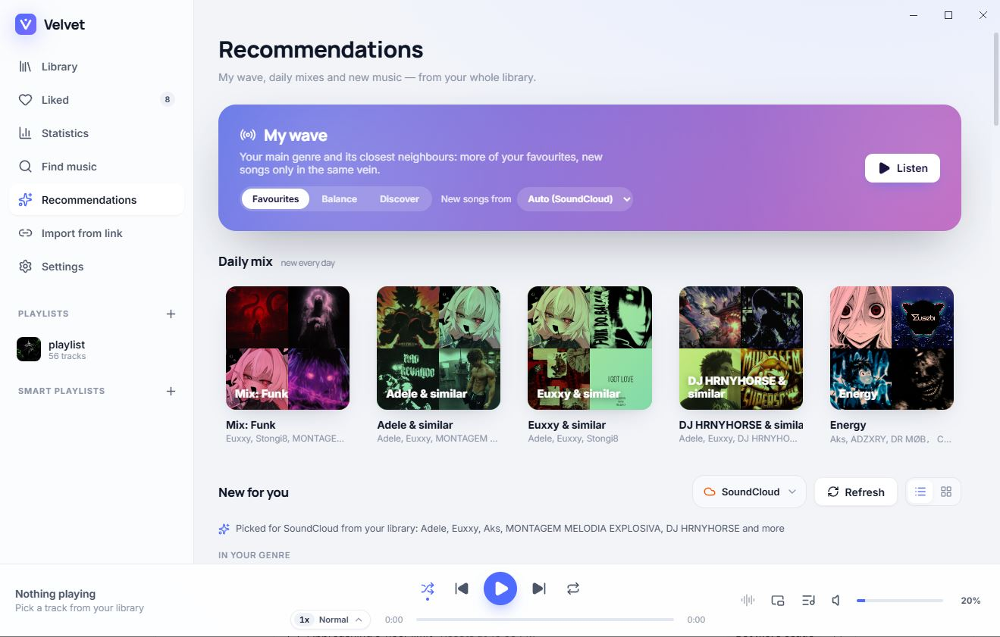
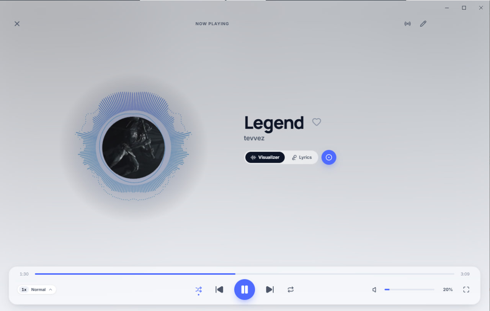
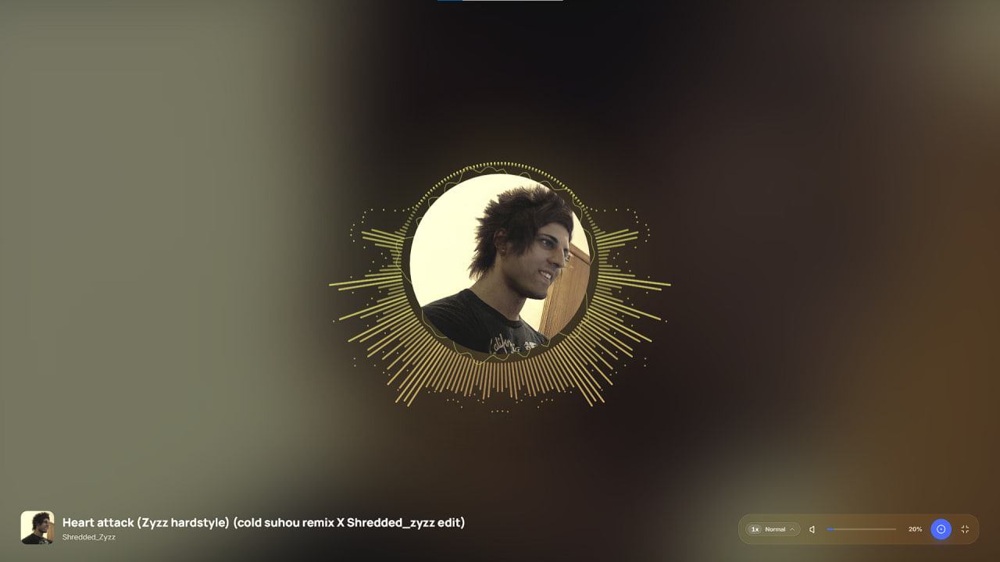

<p align="center">
  🇷🇺 <a href="README.md">Русский</a> &nbsp;|&nbsp; 🇬🇧 <b>English</b>
</p>

# Velvet — music player



**Version 3.0.0** · [releases](https://github.com/Xtop1337/Velvet-music-player/releases)

A desktop player built with **Rust (Tauri 2) + React + TypeScript**: speed up to 3x, slowed / nightcore / reverb presets,
volume up to 200% without distortion, "My Wave" and recommendations based on your library, track radio, smart playlists,
word-by-word lyrics, Spotify-style Discord activity, a tag editor, and import by link from SoundCloud,
YouTube and Spotify.

Since version 2, Velvet is written in Rust instead of Electron: instead of a bundled Chromium and Node.js, the window is
rendered by the system WebView2 (already included in Windows 10/11), and all the work with files, tags, Discord, import and
export is done in Rust. The installer is about 10 MB instead of ~100 MB, and when paused or minimized Velvet uses almost no CPU.

## Building on Windows

Install once:

1. **Rust** — <https://rustup.rs> (rustup-init.exe, all defaults).
2. **Microsoft C++ Build Tools** — <https://visualstudio.microsoft.com/visual-cpp-build-tools/>;
   in the installer, select *Desktop development with C++*.
3. **Node.js 20+** — <https://nodejs.org>.

WebView2 is already installed on Windows 10/11; if it's missing, the Velvet installer will download it automatically.

Then, in the project folder:

```bash
npm install
npm run dev        # development mode (window with hot reload of the UI)
npm run dist:win   # installer: src-tauri/target/release/bundle/nsis/Velvet_3.0.0_x64-setup.exe
```

The first Rust build takes 5–10 minutes; subsequent builds are faster. Checks: `npm run typecheck`, `npm test`
(UI), `cargo test` and `cargo clippy` in the `src-tauri` folder (backend).

### Common errors

- `npm error Unsupported URL Type "dist:": dist:win` — you typed `npm install dist:win` instead of `npm run dist:win`.
- `linker 'link.exe' not found` / `error: Microsoft C++ build tools` — C++ Build Tools are not installed (step 2).
- `cargo: command not found` — open a new terminal window after installing Rust.

### Migrating from the Electron version

Nothing needs to be migrated: Velvet (versions 2 and 3) uses the same data folder `%APPDATA%\Velvet` — library,
playlists, favorites, statistics, settings, covers, lyrics cache and yt-dlp are picked up as is.
The old version can be uninstalled via Windows "Apps" (your data is not deleted).

### ffmpeg

ffmpeg is no longer bundled with the installer: it's only needed for import (transcoding to MP3/M4A) and for exporting
slowed versions, so Velvet downloads it the first time it's needed (BtbN build with rubberband, ~140 MB,
verified by SHA-256) to `%APPDATA%\Velvet\bin`. If ffmpeg is already in your `PATH`, that one is used.

## Features

| | |
|---|---|
| **Speed** | 0.25x – 3x, slider, ±0.05x buttons, quick presets, hotkeys `[` / `]`. The speed indicator sits in a separate "pill" to the left of the progress bar. |
| **Auto pitch** | Toggle in the speed panel and in settings. On — pitch is preserved; off — pitch changes along with speed (classic slowed / nightcore). |
| **Effects and presets** | Reverb, bass, mids, treble. Built-in presets: Normal, Slowed, Slowed + Reverb, Nightcore, Sped Up, Bass Boost, Vaporwave, Concert Hall. Custom presets can be saved. |
| **Per-track speed** | "Apply to current track automatically" in the speed panel remembers the track's speed and effects — a preset or your own slider values. The track then starts with them automatically (including when resuming after launch), and afterwards your usual speed comes back. While a bound track is playing, changes in the panel are saved to the binding. |
| **Volume** | 0–200%, with the percentage shown next to the slider; the zone above 100% is highlighted. Mouse wheel — ±5%, clicking the percentage — 100%. |
| **Clean sound** | A custom look-ahead limiter (AudioWorklet) sits after the volume stage: it lowers gain ahead of peaks, so even 200% + Bass Boost doesn't clip. Track switching and pausing use a micro-fade with no clicks. |
| **Tags** | Title, artist, album, cover (file / link / clipboard). Can be written directly to the file (MP3, FLAC, M4A, OGG…). |
| **Playlists** | Create, rename, set a cover, drag tracks onto a playlist and within a playlist. |
| **Import** | SoundCloud (track, set, profile) and YouTube — directly via yt-dlp. Spotify (track, album, playlist) — metadata and covers come from Spotify, audio is matched on YouTube / SoundCloud. yt-dlp is downloaded automatically. |
| **Design** | Themes **Snow** (snow white), **Midnight** (dark blue with white), **Glass / Aurora** (glass and cover colors), "Match system". Accent color, color from cover, corner radius, text size, density, background image with blur. |
| **Languages** | Auto-detected from the system language; Русский, English, Українська, Deutsch, Español, Français (Settings → Language). |
| **Crossfade and gapless** | Smooth transition between tracks (0–12 s) and gapless playback. Off by default (Settings → Playback). |
| **Lyrics** | "Karaoke" lyrics: only the lines around the current one are visible. **Word by word** (toggle in the "Lyrics" tab, on by default) — highlights exactly the word being sung: using word timestamps if the lyrics have them (enhanced LRC), otherwise by syllables and the singing tempo of that track; when off, the line fills smoothly. Highlighting follows what you actually hear (audio output latency and playback speed are taken into account). For slowed / sped up / nightcore versions, the original's lyrics are used and stretched to the file's length ("Fit to track length" button). "− / +" shift the lyrics by 0.1 s for this track if they're timed inaccurately. Sources: file tags, LRCLIB, or your own LRC in the tag editor; lyrics without timestamps scroll approximately. Click a line to seek. |
| **Favorites and statistics** | ♥ on any track, "Favorites" section. "Statistics": listening time, top tracks/artists/albums for 7/30 days, the year and all time, a daily chart, **genres and decades**. |
| **Albums and artists** | Library view as tracks, an album grid or artists; album and artist pages; sorting; multi-select (Ctrl/Shift-click, Ctrl+A). |
| **Mini player and tray** | Compact always-on-top window, tray icon, minimize to tray, track change notifications, global hotkeys Ctrl+Alt+Space / ←→ / ↑↓. |
| **Exporting slowed versions** | "Export with effects": saves the track with the current speed, pitch, reverb and EQ as MP3 320 / FLAC / WAV (ffmpeg + rubberband, −0.3 dBFS limiter). |
| **Search** | Search tracks on SoundCloud, YouTube and Spotify right in the player: on the right side of the search bar there's a service button with an arrow that opens a dropdown (SoundCloud by default, your choice is remembered). Preview and download in one click. Spotify requires your own keys (see below); the audio for a Spotify track comes from YouTube / SoundCloud. |
| **Recommendations ("For You")** | Analyzes your **entire** library: listening time (recent counts more), 👍 and 👎, play counts, skips. A track's genre is determined by its tag, by words in the title (phonk, funk, montagem, mtg…) and by the genre of its SoundCloud page — catalogs file phonk and Brazilian funk under "rap" or "electronic", so this matters. **My Wave** — an endless stream; on its card you choose the **mode** ("Favorites" — your main genre and the closest ones, more of your own tracks; "Balance"; "Discovery" — mostly new music and neighboring genres) and the **source** of new tracks (Auto / SoundCloud / YouTube; "Auto" picks the service you have more tracks from). New music is found from your own tracks: SoundCloud "related tracks" or YouTube "Mix" based on tracks from your main genre, plus artists similar to yours (the open Deezer catalog, the name must match exactly); compilations, hour-long mixes and off-genre tracks are filtered out. The wave starts playing immediately — from your own tracks — and new ones are added as they're found. **Daily Mix** — up to 6 auto-playlists by genre and mood; new tracks are taken from the mix's own tracks. **Forgotten tracks** — favorites that haven't played in 45+ days. **New for you** — the same selection, first "In your genre", then "Close to your taste". Rows or tiles. |
| **Track radio** | In the track menu, on the "Now Playing" screen and on recommendations: an endless queue of similar tracks strictly within the source track's genre. New tracks play straight from the internet without downloading (speed and effects work), and if you like one — hit "Download". **The next track is prepared in advance**: a few seconds after the current one starts, the next is found, downloaded to a temporary file and loaded into the spare deck, so the transition is seamless (temporary files are deleted on exit). Offline — similar tracks from your library. |
| **👍 and 👎** | On recommendations, in the player and on the "Now Playing" screen for online tracks, and in the track menu. 👍 "Like" only trains recommendations (it doesn't download anything): more of that artist and genre, and the track becomes a starting point for the wave. 👎 "Not interested": the track is no longer suggested; after two dislikes the artist isn't either, and the genre is suggested less often. Pressing again removes the rating. A wave track played to the end counts as a small like; one skipped in the first 30 seconds — a small dislike. All ratings are visible and can be undone in *Settings → Recommendations: your ratings*. |
| **Smart playlists** | "Smart playlists" in the sidebar: rules by plays (total / last 30 days), favorites, date added, "not played for N days", genre, artist, year, BPM, key and mode, duration, source, note; "all rules" or "any"; order and limit. Ready-made templates: "Often played but not in favorites", "Added this week", "Forgotten favorites", "Fast / calm", "Twenty years ago". They update automatically. |
| **BPM and key** | Velvet analyzes audio in the background (one track at a time, without getting in the way): tempo, key (e.g. A minor / 8A on the Camelot wheel) and energy; values from tags (TBPM, TKEY) take priority. A "BPM · key" column, sorting by tempo and by the Camelot wheel. Genre and year for untagged tracks come from the open Deezer catalog (can be turned off: Settings → Track analysis). |
| **Tiles** | A "Rows / Tiles" toggle in the library, favorites, playlists, albums, artists, mixes, smart playlists, search and recommendations; the choice is remembered per page. |
| **Notes** | On a track (menu → "Note…" or the tag editor), on a playlist and on a smart playlist. An icon in the row, the text on the "Now Playing" screen; library search also searches notes. |
| **Visualizer** | A separate full-window screen (button in the player or the V key). The bottom bar (progress, buttons, volume up to 200%, speed and effects) fades out smoothly when the mouse isn't over it. Modes use the cover's colors and the exact spectrum (FFT 8192): "Bars" — up to 128 bars with falling peaks and reflection; "Wave" — a jitter-free oscilloscope with full detail; "Circle" — 180 mirrored bars, a wave around the cover and rings on beats; "Particles" — particles from every part of the spectrum and a "living" core. Full screen — button in the corner or F; volume and speed at the bottom. |
| **Background** | Live from the cover (pulses with the bass), an image or a video. |
| **Hotkeys** | Customizable: you can change, add and remove shortcuts — both in-app and global (they work while Velvet is minimized). Work with any keyboard layout. |
| **Updates** | Checks for new versions on GitHub and shows an "Update available" window (see below). |
| **Media keys** | The ⏯ ⏭ ⏮ keys on the keyboard and the Windows system panel (above the volume control) with the title and cover. |

## Discord activity

Works out of the box: Velvet has a built-in Discord application "Velvet" (Application ID `1562774102274740256`,
the `DEFAULT_CLIENT_ID` constant in `src-tauri/src/discord/mod.rs`). While Velvet and Discord are running, your profile
shows "Listening to Velvet": cover, title, artist, album and a progress bar (speed-aware),
with a ▶ or ⏸ icon in the corner of the cover. When paused — "⏸ Paused" and the timer stops; optionally, the activity
can be hidden while paused. In Discord, the "Display current activity as a status message" option must be enabled
(Settings → Activity Privacy).

Discord loads the logo (when a track has no cover) and the ▶ / ⏸ icons via links to this repository —
the `assets/discord` folder must be present in the `main` branch of the public repository
`Xtop1337/Velvet-music-player`.

Cover in the activity: for SoundCloud/Spotify tracks — the original cover; for local tracks — the link from the tag
editor, otherwise one found via iTunes Search, otherwise **the track's own cover**: Discord only shows images
by URL, so Velvet uploads a downscaled copy (JPEG 512 px) to catbox.moe and shows that. Each
cover is uploaded only once (links are remembered by image hash in `cache/cover-upload.json`), and only
while Discord is connected. The link is public — uploading can be turned off in *Settings → Discord → Show your own
track cover*. If there's no cover at all — the Velvet logo.

You only need your own Discord application if you want a different name instead of "Velvet": create one at
<https://discord.com/developers/applications> and enter its Application ID in
*Settings → Discord → Custom Discord application*. An empty field means Velvet again.

## Updates

Velvet checks releases on GitHub — <https://github.com/Xtop1337/Velvet-music-player/releases> — at startup
and every 6 hours (can be turned off or checked manually in "Settings → About"). If a version newer than
the installed one is out, an "Update available" window appears with the version number and changelog; the "Update" button
opens the release page, where you can download the new installer. A reminder stays in the sidebar until you update.

How to publish a new version:

1. Bump the version number (e.g. `3.0.1`) in three places: `package.json`, `src-tauri/Cargo.toml`,
   `src-tauri/tauri.conf.json`. The `package-lock.json` and `src-tauri/Cargo.lock` files update themselves on
   `npm install` and build.
2. Add the changes to `CHANGELOG.md` and build the installer: `npm run dist:win`.
3. On GitHub: *Releases → Draft a new release*, tag `v3.0.1` (the `v` prefix is optional), describe
   what's new in the description, attach `src-tauri/target/release/bundle/nsis/Velvet_3.0.1_x64-setup.exe` and click
   *Publish release*. Drafts and pre-releases are ignored.

The "Update available" window shows the first 600 characters of the release description, so put the most important
things at the beginning.

The repository address is set in `src-tauri/src/updater.rs` (the `REPO` constant).

## Spotify with and without keys

Without keys, Velvet reads Spotify's public embed page (up to ~100 tracks per playlist) — that's enough for importing
by link. Keys are needed for full playlists, **Spotify search** and **Spotify recommendations**: each
user creates their own app at <https://developer.spotify.com/dashboard> (*Create app*; for the Redirect URI,
`http://127.0.0.1:8888/callback` will do — it isn't used) and pastes the Client ID / Secret into *Settings → Import* (the "Add keys"
button on the search page takes you there). No keys are built into Velvet.

Spotify restrictions since February 2026 for apps in Development mode: the app owner needs
Spotify Premium, search returns up to 10 tracks per request (Velvet pages through results itself), and Spotify has closed
recommendations and artist top tracks — so Velvet gets similar artists from Deezer and searches for their tracks on Spotify.
If Spotify returns 403, check Premium and *User Management* in the Dashboard. Only download what you have
the rights to.

## Project structure

```
src-tauri/                Rust backend (Tauri 2)
  src/lib.rs              window, plugins, close to tray, saving before exit
  src/commands.rs         commands called by the UI (window.velvet)
  src/protocol.rs         velvet:// protocol for audio, covers and video (Range — seeking works)
  src/library.rs, tags.rs folder scanning and tags (lofty), in parallel (rayon)
  src/discord/            custom Discord RPC client (named pipe) and pause logic
  src/importer.rs, spotify.rs, matcher.rs, search.rs   import by link and search (yt-dlp, Spotify Web API)
  src/recommend.rs        selection: SoundCloud related tracks / YouTube mix from your tracks (wave_candidates), Deezer artist graph
  src/deezer.rs           open Deezer API: similar artists, top tracks, artist radio, previews, genre and year (disk cache)
  src/stream.rs           online tracks: audio lookup (yt-dlp), relaying with Range, temporary download of the next track
  src/analysis.rs         BPM, key and energy from audio (symphonia), background queue
  src/media_server.rs     local HTTP server: audio (Linux and Windows), covers for the Windows panel, online streams
  src/lyrics.rs, exporter.rs, tools.rs                 lyrics (LRCLIB), export (ffmpeg), downloading yt-dlp/ffmpeg
  src/remote.rs           tray, mini player, global hotkeys, notifications, Windows media keys
  src/updater.rs          checking for new versions on GitHub (Xtop1337/Velvet-music-player)
  tauri.conf.json         window, installer
src/                      UI (React)
  bridge.ts               window.velvet on top of Tauri commands and events
  audio/                  engine: decks A/B (crossfade) → EQ → reverb → volume → fade → limiter (Web Audio)
  store/                  zustand: player, library, settings, imports, ui
  components/, pages/     UI; components/WindowControls.tsx — window buttons
  mini/                   mini player window
  styles/                 themes.css (theme tokens), global.css
  i18n/                   ru, en, uk, de, es, fr
  shared/                 shared types, presets, hotkeys, link parser
tests/                    UI unit tests (vitest); backend tests are in src-tauri (cargo test)
```

Data (library, settings, cover cache, yt-dlp, ffmpeg) is stored in the app folder:
`%APPDATA%\Velvet` (Windows), `~/.config/Velvet` (Linux).

## Troubleshooting

**No sound.** Open *Settings → Playback → Test sound*: a short beep will play and a summary will appear
(what the audio is going through, AudioContext state, the last error). Velvet automatically tries a second way of loading
the file if the first one fails, and automatically enables "Simple audio mode" if nothing can be heard through the effects;
this mode can also be enabled manually (effects, the equalizer and volume above 100% don't work in it).

Velvet writes a log (startup, errors, exit steps) to
`%LOCALAPPDATA%\app.velvet.player\logs\velvet.log` (Windows; on Linux — `~/.local/share/app.velvet.player/logs`).
Please attach it to bug reports.

Closing: after clicking ✕ (or "Exit" in the tray), Velvet saves the library and settings and quits; if something
hangs, the process will still terminate on its own within 6 seconds — no need to kill it in Task Manager.
