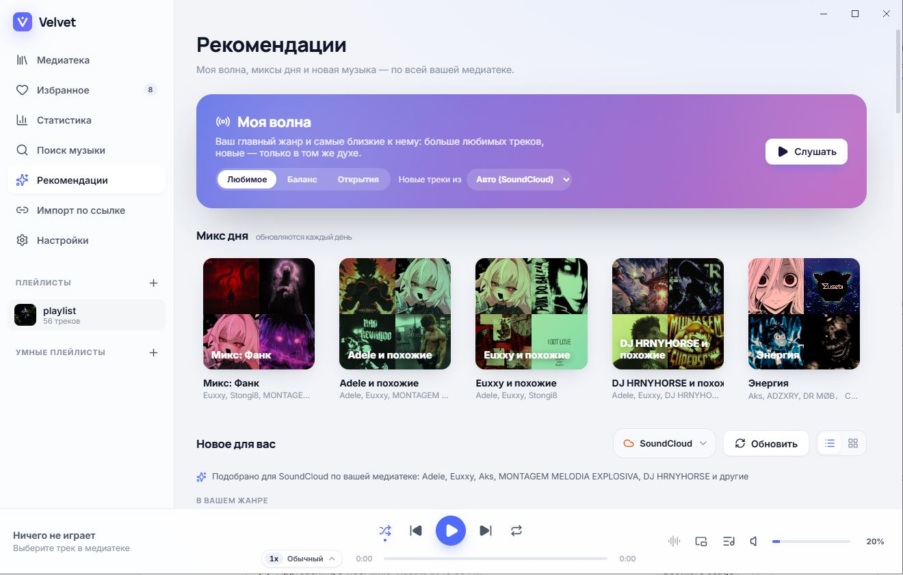

<p align="center">
  🇷🇺 <b>Русский</b> &nbsp;|&nbsp; 🇬🇧 <a href="README.en.md">English</a>
</p>

# Velvet — музыкальный плеер


**Версия 3.0.0** · [релизы](https://github.com/Xtop1337/Velvet-music-player/releases)

Десктопный плеер на **Rust (Tauri 2) + React + TypeScript**: скорость до 3x, slowed / nightcore / reverb-пресеты,
громкость до 200% без хрипов, «Моя волна» и рекомендации по вашей медиатеке, радио по треку, умные плейлисты,
текст песен по словам, Discord-активность как у Spotify, редактор тегов и импорт по ссылке из SoundCloud,
YouTube и Spotify.

Начиная с версии 2 Velvet написан на Rust вместо Electron: вместо встроенного Chromium и Node.js окно рисует
системный WebView2 (он уже есть в Windows 10/11), а вся работа с файлами, тегами, Discord, импортом и экспортом —
на Rust. Установщик весит около 10 МБ вместо ~100 МБ, а на паузе и в свёрнутом окне Velvet почти не тратит процессор.

## Сборка в Windows

Один раз установите:

1. **Rust** — <https://rustup.rs> (rustup-init.exe, всё по умолчанию).
2. **Microsoft C++ Build Tools** — <https://visualstudio.microsoft.com/visual-cpp-build-tools/>,
   в установщике отметьте «Разработка классических приложений на C++» (*Desktop development with C++*).
3. **Node.js 20+** — <https://nodejs.org>.

WebView2 в Windows 10/11 уже установлен; если его нет, установщик Velvet скачает его сам.

Затем в папке проекта:

```bash
npm install
npm run dev        # режим разработки (окно с горячей перезагрузкой интерфейса)
npm run dist:win   # установщик: src-tauri/target/release/bundle/nsis/Velvet_3.0.0_x64-setup.exe
```

Первая сборка Rust занимает 5–10 минут, следующие — быстрее. Проверки: `npm run typecheck`, `npm test`
(интерфейс), `cargo test` и `cargo clippy` в папке `src-tauri` (бэкенд).

### Частые ошибки

- `npm error Unsupported URL Type "dist:": dist:win` — вместо `npm run dist:win` набрано `npm install dist:win`.
- `linker 'link.exe' not found` / `error: Microsoft C++ build tools` — не установлены C++ Build Tools (пункт 2).
- `cargo: command not found` — после установки Rust откройте новое окно терминала.

### Переход с версии на Electron

Ничего переносить не нужно: Velvet (версии 2 и 3) работает с той же папкой данных `%APPDATA%\Velvet` — медиатека,
плейлисты, избранное, статистика, настройки, обложки, кэш текстов и yt-dlp подхватываются как есть.
Старую версию можно удалить через «Приложения» Windows (данные при этом не удаляются).

### ffmpeg

ffmpeg больше не входит в установщик: он нужен только для импорта (перекодирование в MP3/M4A) и экспорта
slowed-версий, поэтому Velvet скачивает его при первой необходимости (сборка BtbN с rubberband, ~140 МБ,
проверяется по SHA-256) в `%APPDATA%\Velvet\bin`. Если ffmpeg уже есть в `PATH`, используется он.

## Возможности

| | |
|---|---|
| **Скорость** | 0.25x – 3x, слайдер, кнопки ±0.05x, быстрые значения, горячие клавиши `[` / `]`. Индикатор скорости вынесен в отдельную «пилюлю» слева от полосы прогресса. |
| **Автотональность** | Переключатель в панели скорости и в настройках. Вкл — тон сохраняется; выкл — тон меняется вместе со скоростью (классический slowed / nightcore). |
| **Эффекты и пресеты** | Реверберация, басы, середина, высокие. Встроенные пресеты: Обычный, Slowed, Slowed + Reverb, Nightcore, Sped Up, Bass Boost, Vaporwave, Концертный зал. Свои пресеты сохраняются. |
| **Скорость для трека** | «Применять к текущему треку автоматически» в панели скорости запоминает для трека его скорость и эффекты — пресет или свои значения с ползунка. Трек сам включается с ними (и при продолжении после запуска), после него возвращается ваша обычная скорость. Пока привязанный трек играет, изменения в панели сохраняются в привязку. |
| **Громкость** | 0–200%, рядом с ползунком показывается процент; зона выше 100% подсвечена. Колесо мыши — ±5%, клик по проценту — 100%. |
| **Чистый звук** | После громкости стоит собственный look-ahead лимитер (AudioWorklet): он заранее снижает усиление перед пиками, поэтому даже 200% + Bass Boost не клиппуют. Переключение треков и пауза — с микро-фейдом без щелчков. |
| **Теги** | Название, исполнитель, альбом, обложка (файл / ссылка / буфер обмена). Можно записать прямо в файл (MP3, FLAC, M4A, OGG…). |
| **Плейлисты** | Создание, переименование, обложка, перетаскивание треков на плейлист и внутри плейлиста. |
| **Импорт** | SoundCloud (трек, сет, профиль) и YouTube — напрямую через yt-dlp. Spotify (трек, альбом, плейлист) — метаданные и обложки из Spotify, аудио подбирается на YouTube / SoundCloud. yt-dlp скачивается автоматически. |
| **Дизайн** | Темы **Snow** (белоснежная), **Midnight** (тёмно-синяя с белым), **Glass / Aurora** (стекло и цвета обложки), «Как в системе». Акцентный цвет, цвет из обложки, скругление, размер текста, плотность, фоновое изображение с размытием. |
| **Языки** | Автоопределение по языку системы; русский, English, українська, Deutsch, Español, Français (Настройки → Язык). |
| **Кроссфейд и gapless** | Плавный переход между треками 0–12 с и воспроизведение без пауз. По умолчанию выключены (Настройки → Воспроизведение). |
| **Тексты песен** | «Караоке»-текст: видны только строки рядом с текущей. **По словам** (переключатель во вкладке «Текст», по умолчанию включён) — подсвечивается именно то слово, которое поют: по меткам слов, если они есть в тексте (расширенный LRC), иначе по слогам и темпу пения этого трека; выключено — строка заполняется плавно. Подсветка идёт по тому, что реально слышно (учитывается задержка вывода звука и скорость воспроизведения). Для версий slowed / sped up / nightcore берётся текст оригинала и растягивается под длину файла (кнопка «Под длину трека»). «− / +» сдвигают текст на 0,1 с для этого трека, если он размечен неточно. Источник — теги файла, LRCLIB или свой LRC в редакторе тегов; текст без таймкодов прокручивается примерно. Клик по строке — перемотка. |
| **Избранное и статистика** | ♥ у любого трека, раздел «Избранное». «Статистика»: время прослушивания, топ треков/исполнителей/альбомов за 7/30 дней, год и всё время, график по дням, **жанры и десятилетия**. |
| **Альбомы и исполнители** | Медиатека в виде треков, сетки альбомов или исполнителей; страницы альбома и артиста; сортировка; мультивыбор (Ctrl/Shift-клик, Ctrl+A). |
| **Мини-плеер и трей** | Компактное окно поверх всех, значок в трее, сворачивание в трей, уведомления о смене трека, глобальные клавиши Ctrl+Alt+Space / ←→ / ↑↓. |
| **Экспорт slowed-версий** | «Экспорт с эффектами»: сохраняет трек с текущей скоростью, тональностью, ревербом и EQ в MP3 320 / FLAC / WAV (ffmpeg + rubberband, лимитер −0.3 dBFS). |
| **Поиск** | Поиск треков на SoundCloud, YouTube и Spotify прямо в плеере: справа в строке поиска — кнопка сервиса со стрелкой, по нажатию раскрывается список (по умолчанию SoundCloud, выбор запоминается). Предпрослушивание и скачивание в один клик. Для Spotify нужны свои ключи (см. ниже); звук трека Spotify берётся с YouTube / SoundCloud. |
| **Рекомендации («Для вас»)** | Анализ **всей** медиатеки: время прослушивания (недавнее весит больше), 👍 и 👎, число прослушиваний, пропуски. Жанр трека определяется по тегу, по словам в названии (phonk, funk, montagem, mtg…) и по жанру страницы SoundCloud — каталоги записывают фонк и бразильский фанк в «рэп» или «электронику», поэтому это важно. **Моя волна** — бесконечный поток; на карточке выбираются **режим** («Любимое» — ваш главный жанр и самые близкие, больше своих треков; «Баланс»; «Открытия» — в основном новое и соседние жанры) и **источник** новых треков (Авто / SoundCloud / YouTube; «Авто» — сервис, откуда у вас больше треков). Новое подбирается от ваших же треков: «похожие треки» SoundCloud или «Микс» YouTube по трекам главного жанра плюс исполнители, похожие на ваших (открытый каталог Deezer, имя должно совпасть точно); сборники, часовые миксы и чужие жанры отбрасываются. Волна начинает играть сразу — со своих треков, новые добавляются по мере нахождения. **Микс дня** — до 6 автоплейлистов по жанрам и настроению, новые треки берутся от треков самого микса. **Забытые треки** — любимое, что не звучало 45+ дней. **Новое для вас** — тот же отбор, сначала «В вашем жанре», потом «Рядом с вашим вкусом». Строки или плитки. |
| **Радио по треку** | В меню трека, на экране «Сейчас играет» и у рекомендаций: бесконечная очередь похожих треков строго в жанре исходного. Новые треки играют сразу из интернета без скачивания (скорость и эффекты работают), понравившийся — кнопка «Скачать». **Следующий трек готовится заранее**: через несколько секунд после начала текущего он находится, скачивается во временный файл и загружается в запасную деку, поэтому переход идёт без паузы (временные файлы удаляются при выходе). Без интернета — похожие из медиатеки. |
| **👍 и 👎** | У рекомендаций, в плеере и на экране «Сейчас играет» для треков из интернета, в меню трека. 👍 «Нравится» только учит рекомендации (ничего не скачивает): больше такого исполнителя и жанра, трек становится отправной точкой волны. 👎 «Не интересно»: трек больше не предлагается, после двух отказов — и исполнитель, жанр предлагается реже. Повторное нажатие снимает оценку. Трек волны, дослушанный до конца, — маленький лайк, пропущенный в первые 30 секунд — маленький дизлайк. Все оценки видны и отменяются в *Настройки → Рекомендации: ваши оценки*. |
| **Умные плейлисты** | «Умные плейлисты» в сайдбаре: правила по прослушиваниям (всего / за 30 дней), избранному, дате добавления, «не играл N дней», жанру, исполнителю, году, BPM, тональности и ладу, длительности, источнику, заметке; «все правила» или «любое»; порядок и лимит. Готовые шаблоны: «Часто слушаю, но не в избранном», «Добавлено за неделю», «Забытые любимые», «Быстрые / спокойные», «Двадцать лет назад». Обновляются сами. |
| **BPM и тональность** | Velvet в фоне анализирует звук (по одному треку, не мешая): темп, тональность (например A minor / 8A по Camelot) и энергию; значения из тегов (TBPM, TKEY) имеют приоритет. Колонка «BPM · тон», сортировка по темпу и по кругу Camelot. Жанр и год для треков без тегов — из открытого каталога Deezer (можно выключить: Настройки → Анализ треков). |
| **Плитки** | Переключатель «Строки / Плитки» в медиатеке, избранном, плейлистах, альбомах, у исполнителей, в миксах, умных плейлистах, поиске и рекомендациях; выбор запоминается для каждой страницы. |
| **Заметки** | К треку (меню → «Заметка…» или редактор тегов), к плейлисту и умному плейлисту. Значок в строке, текст на экране «Сейчас играет»; поиск по медиатеке ищет и в заметках. |
| **Визуализатор** | Отдельный экран на всё окно (кнопка в плеере или клавиша V). Нижняя плашка (прогресс, кнопки, громкость до 200%, скорость и эффекты) плавно прячется, когда мышь не на ней. Режимы — в цветах обложки, по точному спектру (FFT 8192): «Полосы» до 128 полос с падающими пиками и отражением, «Волна» — осциллограф без дрожания с полной детализацией, «Круг» — 180 зеркальных полос, волна вокруг обложки и кольца на ударах, «Частицы» — частицы от каждой части спектра и «живое» ядро. Полный экран — кнопка в углу или F; внизу громкость и скорость. |
| **Фон** | Живой из обложки (пульсирует в такт басам), картинка или видео. |
| **Горячие клавиши** | Настраиваются: можно менять, добавлять и удалять сочетания — для приложения и глобальные (работают, когда Velvet свёрнут). Работают при любой раскладке. |
| **Обновления** | Проверка новых версий на GitHub и окно «Доступно обновление» (см. ниже). |
| **Медиаклавиши** | Клавиши ⏯ ⏭ ⏮ на клавиатуре и системная панель Windows (над регулятором громкости) с названием и обложкой. |

## Discord-активность

Работает сразу: в Velvet встроено приложение Discord «Velvet» (Application ID `1562774102274740256`,
константа `DEFAULT_CLIENT_ID` в `src-tauri/src/discord/mod.rs`). Пока Velvet и Discord запущены, в профиле
видно «Слушает Velvet»: обложка, название, исполнитель, альбом и полоса прогресса (с учётом скорости),
в углу обложки — значок ▶ или ⏸. На паузе — «⏸ Пауза», время останавливается; по желанию активность на
паузе можно скрывать. В Discord должна быть включена опция «Отображать текущую активность»
(Настройки → Конфиденциальность активности).

Логотип (когда у трека нет обложки) и значки ▶ / ⏸ Discord берёт по ссылкам из этого репозитория —
папка `assets/discord` должна лежать в ветке `main` публичного репозитория
`Xtop1337/Velvet-music-player`.

Обложка в активности: у треков из SoundCloud/Spotify — исходная обложка; у локальных — ссылка из редактора
тегов, иначе найденная через iTunes Search, иначе **своя обложка трека**: Discord показывает только картинки
по ссылке, поэтому Velvet загружает её уменьшенную копию (JPEG 512 px) на catbox.moe и показывает её. Каждая
обложка загружается один раз (ссылки запоминаются по хэшу картинки в `cache/cover-upload.json`), и только
пока Discord подключён. Ссылка публичная — загрузку можно выключить в *Настройки → Discord → Показывать свою
обложку трека*. Если обложки нет совсем — логотип Velvet.

Своё приложение Discord нужно, только если хотите другое название вместо «Velvet»: создайте его на
<https://discord.com/developers/applications> и впишите Application ID в
*Настройки → Discord → Своё приложение Discord*. Пустое поле — снова Velvet.

## Обновления

Velvet проверяет релизы на GitHub — <https://github.com/Xtop1337/Velvet-music-player/releases> — при запуске
и раз в 6 часов (можно выключить или проверить вручную в «Настройки → О программе»). Если вышла версия новее
установленной, появляется окно «Доступно обновление» с номером версии и списком изменений; кнопка «Обновить»
открывает страницу релиза, откуда скачивается новый установщик. В сайдбаре до обновления висит напоминание.

Как выпустить новую версию:

1. Поднимите номер версии (например, `3.0.1`) в трёх местах: `package.json`, `src-tauri/Cargo.toml`,
   `src-tauri/tauri.conf.json`. Файлы `package-lock.json` и `src-tauri/Cargo.lock` обновятся сами при
   `npm install` и сборке.
2. Допишите изменения в `CHANGELOG.md` и соберите установщик: `npm run dist:win`.
3. На GitHub: *Releases → Draft a new release*, тег `v3.0.1` (буква `v` не обязательна), в описании —
   что нового, приложите `src-tauri/target/release/bundle/nsis/Velvet_3.0.1_x64-setup.exe` и нажмите
   *Publish release*. Черновики и pre-release не считаются.

В окне «Доступно обновление» показываются первые 600 символов описания релиза, поэтому самое важное пишите
в начале.

Адрес репозитория задан в `src-tauri/src/updater.rs` (константа `REPO`).

## Spotify без ключей и с ключами

Без ключей Velvet читает публичную embed-страницу Spotify (до ~100 треков плейлиста) — для импорта по ссылке
этого достаточно. Ключи нужны для полных плейлистов, **поиска Spotify** и **рекомендаций Spotify**: каждый
пользователь создаёт своё приложение на <https://developer.spotify.com/dashboard> (*Create app*; в Redirect URI
подойдёт `http://127.0.0.1:8888/callback`, он не используется) и вставляет Client ID / Secret в *Настройки → Импорт* (кнопка «Добавить ключи»
на странице поиска ведёт туда). В Velvet ключи не встроены.

Ограничения Spotify с февраля 2026 года для приложений в режиме Development: владельцу приложения нужен
Spotify Premium, поиск отдаёт до 10 треков за запрос (Velvet листает страницы сам), рекомендации и топ-треки
исполнителей Spotify закрыл — поэтому похожих исполнителей Velvet берёт у Deezer, а их треки ищет в Spotify.
Если Spotify отвечает 403, проверьте Premium и *User Management* в Dashboard. Скачивайте только то, на что у вас
есть права.

## Устройство проекта

```
src-tauri/                бэкенд на Rust (Tauri 2)
  src/lib.rs              окно, плагины, закрытие в трей, сохранение перед выходом
  src/commands.rs         команды, которые вызывает интерфейс (window.velvet)
  src/protocol.rs         протокол velvet:// для звука, обложек и видео (Range — работает перемотка)
  src/library.rs, tags.rs сканирование папок и теги (lofty), параллельно (rayon)
  src/discord/            свой клиент Discord RPC (named pipe) и логика паузы
  src/importer.rs, spotify.rs, matcher.rs, search.rs   импорт по ссылкам и поиск (yt-dlp, Spotify Web API)
  src/recommend.rs        подбор: похожие треки SoundCloud / микс YouTube по вашим трекам (wave_candidates), граф исполнителей Deezer
  src/deezer.rs           открытый API Deezer: похожие исполнители, топы, радио исполнителя, отрывки, жанр и год (кэш на диске)
  src/stream.rs           треки из интернета: поиск звука (yt-dlp), ретрансляция с Range, временная загрузка следующего трека
  src/analysis.rs         BPM, тональность и энергия по звуку (symphonia), фоновая очередь
  src/media_server.rs     локальный http-сервер: звук (Linux и Windows), обложки для панели Windows, потоки из интернета
  src/lyrics.rs, exporter.rs, tools.rs                 тексты (LRCLIB), экспорт (ffmpeg), загрузка yt-dlp/ffmpeg
  src/remote.rs           трей, мини-плеер, глобальные клавиши, уведомления, медиаклавиши Windows
  src/updater.rs          проверка новых версий на GitHub (Xtop1337/Velvet-music-player)
  tauri.conf.json         окно, установщик
src/                      интерфейс (React)
  bridge.ts               window.velvet поверх команд и событий Tauri
  audio/                  движок: деки A/B (кроссфейд) → EQ → реверб → громкость → фейд → лимитер (Web Audio)
  store/                  zustand: player, library, settings, imports, ui
  components/, pages/     интерфейс; components/WindowControls.tsx — кнопки окна
  mini/                   окно мини-плеера
  styles/                 themes.css (токены тем), global.css
  i18n/                   ru, en, uk, de, es, fr
  shared/                 общие типы, пресеты, горячие клавиши, парсер ссылок
tests/                    юнит-тесты интерфейса (vitest); тесты бэкенда — в src-tauri (cargo test)
```

Данные (медиатека, настройки, кэш обложек, yt-dlp, ffmpeg) хранятся в папке приложения:
`%APPDATA%\Velvet` (Windows), `~/.config/Velvet` (Linux).

## Если что-то пошло не так

**Нет звука.** Откройте *Настройки → Воспроизведение → Проверить звук*: прозвучит короткий сигнал и появится сводка
(через что идёт звук, состояние AudioContext, последняя ошибка). Velvet сам пробует второй способ загрузки файла, если
первый не сработал, и сам включает «Простой режим звука», если через эффекты ничего не слышно; этот режим можно
включить и вручную (эффекты, эквалайзер и громкость выше 100% в нём не работают).

Velvet пишет журнал (запуск, ошибки, шаги выхода) в
`%LOCALAPPDATA%\app.velvet.player\logs\velvet.log` (Windows; на Linux — `~/.local/share/app.velvet.player/logs`).
Его стоит приложить к сообщению об ошибке.

Закрытие: после нажатия ✕ (или «Выход» в трее) Velvet сохраняет медиатеку и настройки и завершается; если что-то
зависло, процесс всё равно завершится сам не позже чем через 6 секунд — снимать его в Диспетчере задач не нужно.
